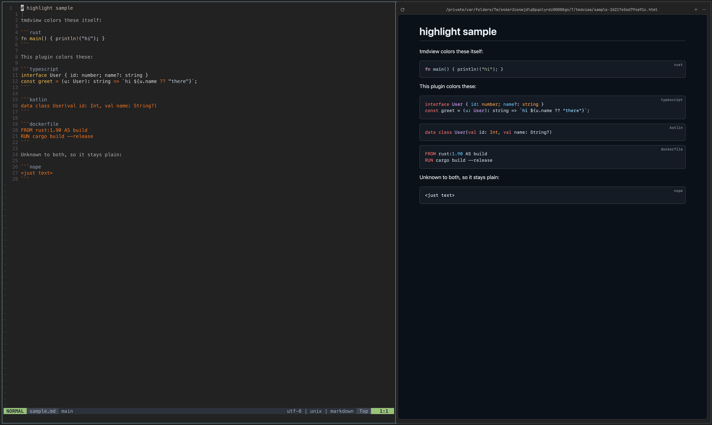

# tmdview-highlight

A [tmdview](https://github.com/slara/terminal-markdown-renderer) plugin that colors code blocks tmdview can't color itself, using [highlight.js](https://highlightjs.org) 11.12.0.

tmdview already colors many languages, such as Rust, Python, Go and JavaScript.
This plugin takes only the rest: TypeScript, Kotlin, Swift, SCSS, GraphQL, Dockerfile, Elixir, Haskell, Nix, Protobuf and the other languages in the standard highlight.js build.
A language neither of them knows stays as plain text.



## Install

```sh
tmdview plugins install slara/tmdview-highlight
```

tmdview then uses it on every page with a matching code block, in tmdview's code colors: GitHub's, in the page's light or dark theme, or yours from `[colors]` in `~/.config/tmdview/config.toml`.
It needs a tmdview with those colors, newer than 0.5.0.
Try it on `sample.md` in this repo.

## Files

| File | Job |
|---|---|
| `tmdview-plugin.toml` | The manifest tmdview reads |
| `init.js` | Colors the blocks tmdview hands to the plugin |
| `styles.css` | Maps highlight.js's classes to tmdview's code colors |
| `vendor/` | highlight.js and extra languages. Generated |
| `scripts/vendor.py` | Downloads `vendor/` for a pinned version |

To change the highlight.js version or add a language, edit `VERSION` or `LANGUAGES` in `scripts/vendor.py`, run `python3 scripts/vendor.py`, and copy the `scripts` list it prints into the manifest.

## License

MIT for this plugin's own files. highlight.js is BSD-3-Clause; see `vendor/LICENSE`.
